我的笔记本没有公网 IP。这件事平时无所谓，直到我想让远端的 AI 直接读写我本机的文件。

ShunCode 的 Bridge 能把本地工作区暴露成一个 MCP 服务，远程智能体连上来就能操作我的文件夹和终端。但前提是那个服务得有个公网地址。家里宽带是 NAT 后面，没有固定 IP，路由器也不在我手上。

Cloudflare Tunnel 就是干这个的：不用公网 IP，不用端口映射，还自带 HTTPS 和开机自启。

那天晚上我从零配到全链路打通。中间踩了五个坑，每一个的报错形式都不一样。这篇是完整记录。

## 先看清楚要填什么

Bridge 面板里内置了 Cloudflare Named Tunnel 模式，配置界面长这样：

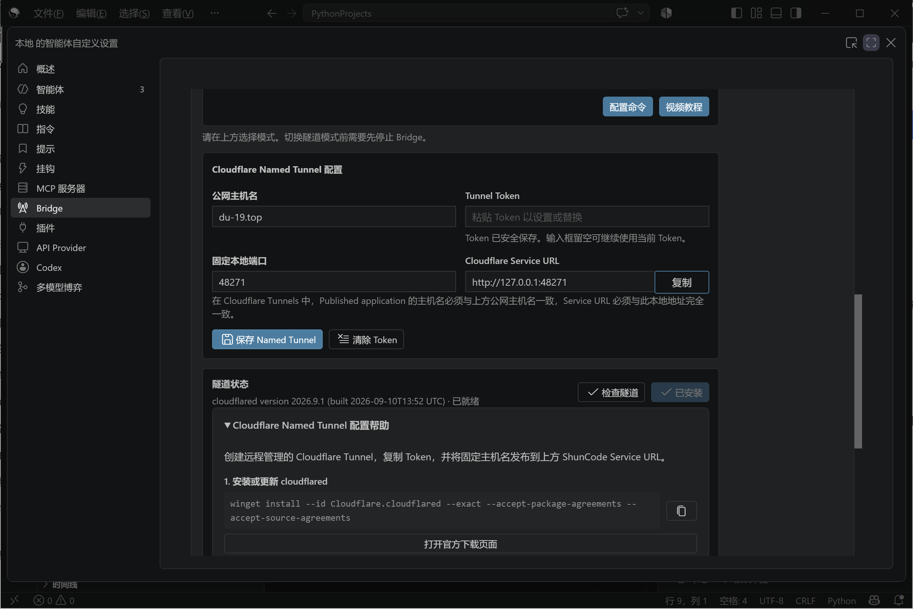

四个字段，一个都不能错：

| 字段 | 填什么 | 关键点 |
| :--- | :--- | :--- |
| 公网主机名 | 你想用的域名，如 `bridge.example.com` | 必须和 Cloudflare 后台 Published application 的主机名**一字不差** |
| Tunnel Token | Cloudflare 隧道的一长串 token（`eyJ...`） | 在 Zero Trust 后台创建隧道时获取，只显示一次 |
| 固定本地端口 | Bridge 服务监听的端口（我的是 `48271`） | 和隧道的 Service URL 必须完全一致 |
| Cloudflare Service URL | `http://127.0.0.1:<端口>` | 隧道收到流量后转发到的本地地址 |

面板自带的帮助把这总结成四步：装 cloudflared、建隧道拿 token、加 Published application 路由、检查 DNS 记录。

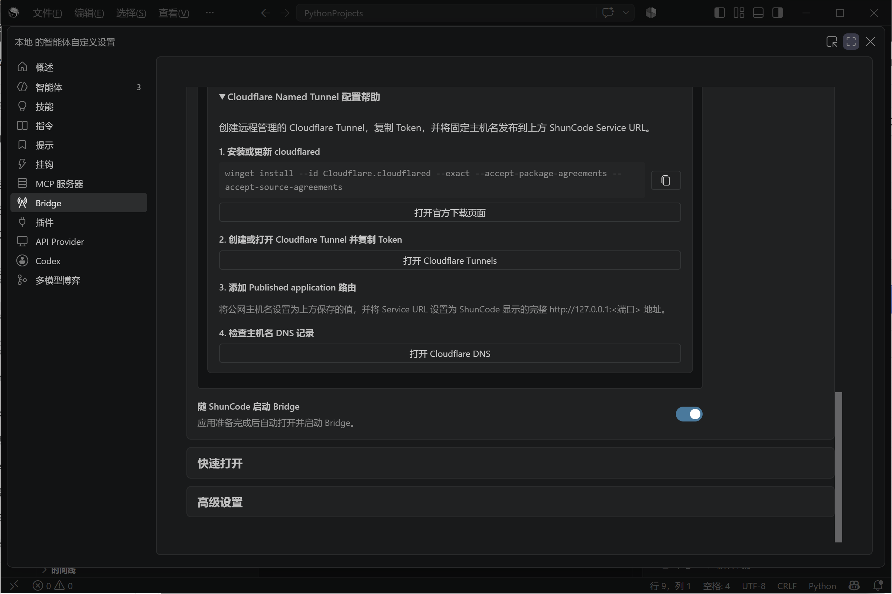

四步。听着简单。实际每一步都埋着东西。

## 起点：面板上写着「尚未安装 cloudflared」

刚开始时 Bridge 面板长这样，「连接设置」一栏明晃晃写着尚未安装 cloudflared，账号授权也还没做：

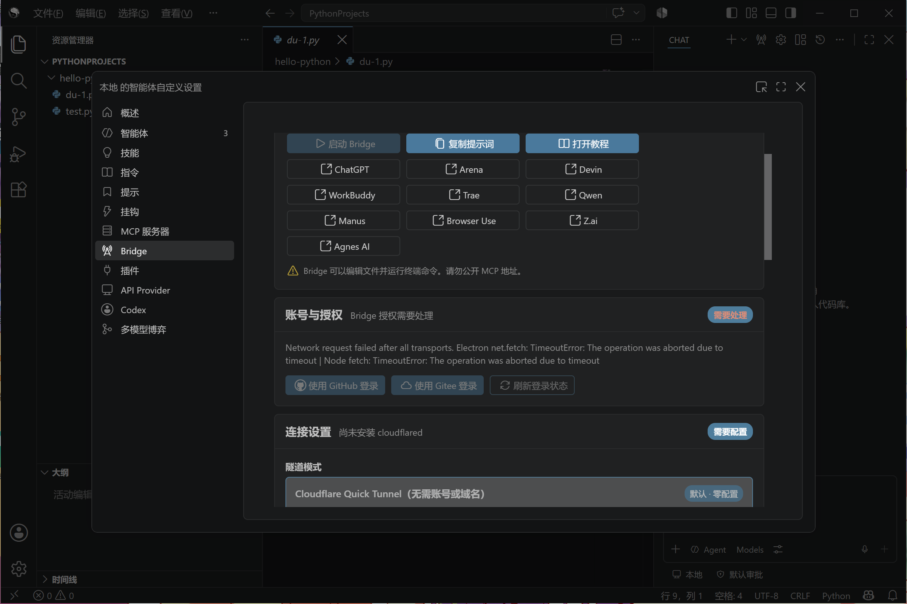

先拿 GitHub 账号完成授权：

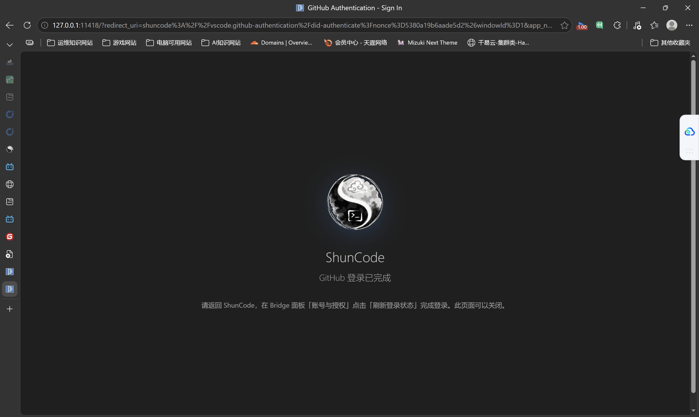

然后进正题。隧道模式要从默认的 Quick Tunnel 升级到 Named Tunnel。区别在于：Quick Tunnel 不用账号，但给你一个每次重启都变的临时域名；Named Tunnel 绑定自己的域名，长期有效。

## 第一步：装 cloudflared，一个不报错的失败

从 [cloudflared 的 GitHub Releases](https://github.com/cloudflare/cloudflared/releases) 下 `cloudflared-windows-amd64.msi`，装完在 `C:\Program Files (x86)\cloudflared\cloudflared.exe`。

然后以管理员身份跑安装服务的命令（token 在 Zero Trust 后台创建隧道时拿）：

```powershell
cloudflared.exe service install <你的隧道token>
```

> [!WARNING]
> 这里有个很阴的坑：**终端不是管理员权限时，这条命令会静默失败**。没有任何报错，看起来正常返回了，但 Windows 服务根本没被创建。
>
> 排查这种问题的正确姿势是先验证前提。`service install` 要写服务控制管理器（SCM），那就先确认自己是不是管理员，再执行。省掉一轮瞎猜。

成功的验证方式：

```powershell
Get-Service cloudflared
# Status: Running  /  StartType: Automatic
```

服务注册成开机自启之后，这台机器和 Cloudflare 之间的加密隧道就常驻了。重启电脑它自己会回来。

## 插曲：顺手把 www 跳到根域

域名既然在手，就把 `www.du-19.top` 到 `du-19.top` 的 301 也配了。Cloudflare 有现成模板（Redirect Rules 里的 `redirect-www-to-root`），核心配置三项：

- 匹配条件：`(http.host eq "www.du-19.top")`
- 重定向类型：**动态**，表达式 `concat("https://du-19.top", http.request.uri.path)`
- 状态码：**301**，勾上 Preserve query string

配完 Cloudflare 立刻甩了个黄色警告：您的 DNS 配置可能不是 www 的代理流量。

这个警告看着像可以忽略，其实是有用的。九成的人卡在这一步：

> [!CAUTION]
> **规则要生效，请求必须先到 Cloudflare 的边缘节点。** 如果 `www` 没有 DNS 记录，或者记录是灰色云（仅 DNS），流量根本不经过 Cloudflare，你写在边缘的规则就是一张废纸。
>
> 解法是补一条占位记录：`A` 类型，名称 `www`，内容 `192.0.2.1`（RFC 保留地址，指向一个不存在的 IP），代理状态必须是橙色云。

## 冲突：根域已经被博客占了

回到正题。打开 DNS 记录页准备给隧道配主机名，看到一个致命问题：

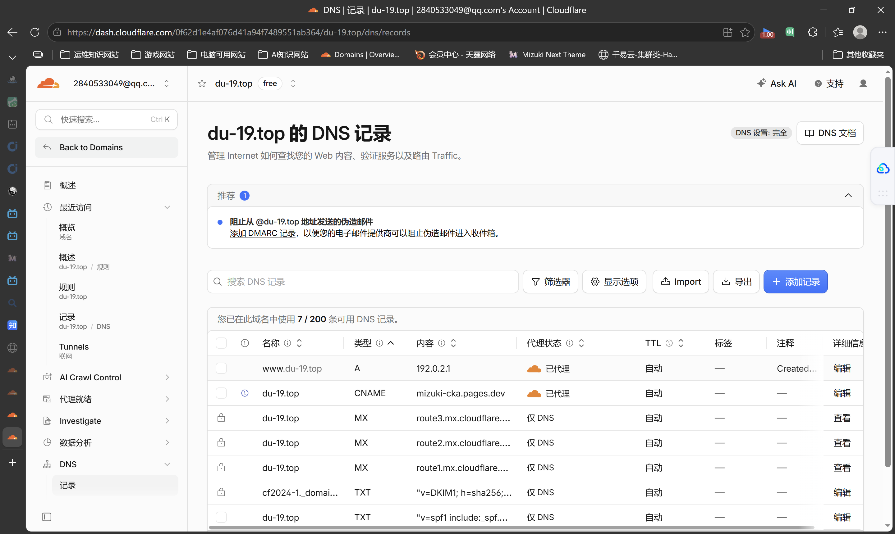

第二行：`du-19.top` 是一条 CNAME，指向 `mizuki-cka.pages.dev`。根域已经是这个博客（Cloudflare Pages）的地盘了。

而我在 Bridge 面板里填的公网主机名，恰恰就是 `du-19.top`。

就算隧道跑起来，访问根域的流量也只会去 Pages 站，永远到不了本机的 48271 端口。我在这儿愣了大概半分钟，才想明白这不是配置错误，是物理事实。

> [!NOTE]
> **一个主机名只能有一个主人。** DNS 解析是路由的第一站，主机名指向谁，流量就去谁那儿。这条原则后面还会再救我一次。

决策很简单：博客保留，Bridge 换子域名 `bridge.du-19.top`。两边同步改，Cloudflare 的隧道路由和 Bridge 面板的公网主机名。

## 第二步：给隧道加 Published application 路由

进 Zero Trust，网络，Tunnels，点进自己的隧道，切到「路由」标签。

一条路由都没有。

这就是根域访问不到 Bridge 的直接原因：

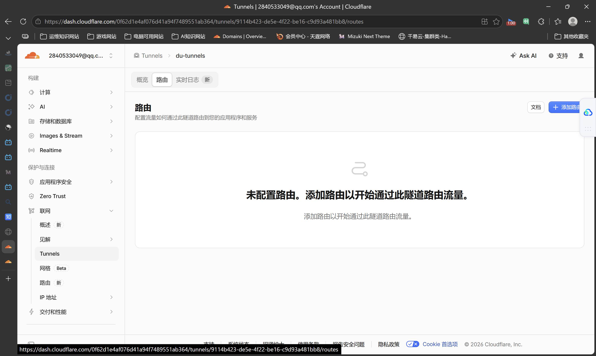

点「添加路由」，四个选项里选**已发布的应用程序**（通过公共主机名把本地应用发布到互联网）：

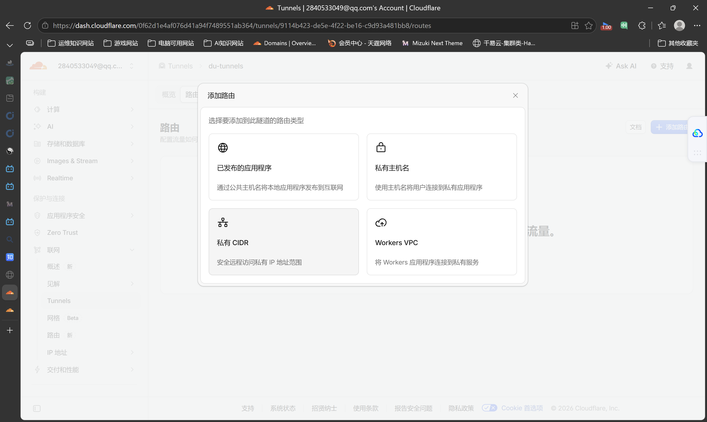

另外三个选项顺手记一下区别，别选错：

- **私有主机名**：Zero Trust 内网用户专用，需要装 WARP 客户端，公网访问不了
- **私有 CIDR**：路由整个 IP 网段，做内网组网用（把笔记本变成 VPN 入口，这是后话）
- **Workers VPC**：对接 Workers 的私有服务

进表单之后留意一个细节：**子域名栏被预填了 `www`**。必须改掉。`www` 半小时前刚被我分配去做 301 重定向，一个主机名不能有两个主人：

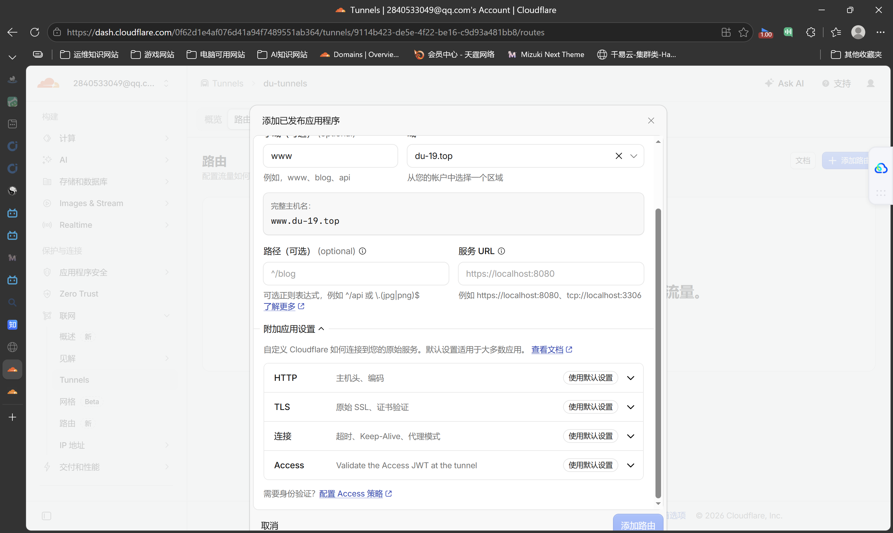

最终配置：

| 字段 | 值 |
| :--- | :--- |
| 子域名 | `bridge` |
| 域 | `du-19.top` |
| 路径 | 留空 |
| 服务 URL | `http://127.0.0.1:48271` |

「附加应用设置」里的 HTTP、TLS、连接、Access 四项全保持默认。

保存后 `bridge.du-19.top` 生效，Cloudflare 会自动创建对应的 CNAME（指向 `<隧道ID>.cfargotunnel.com`）。这就是四步指引里「检查主机名 DNS 记录」要确认的东西。

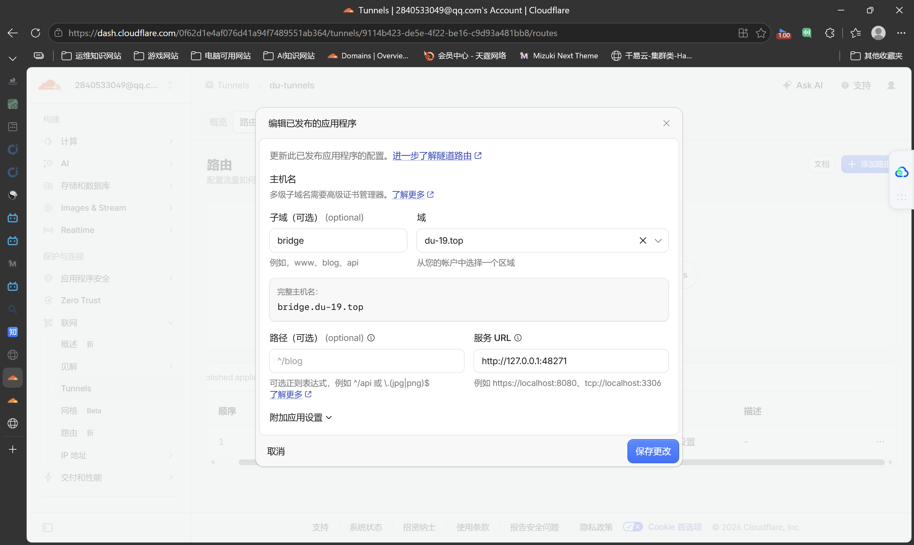

## 第三步：502，三个图标直接指出问题在哪

路由配好，Bridge 面板的公网主机名也同步改完。兴冲冲打开 `https://bridge.du-19.top`。

502 Bad Gateway。

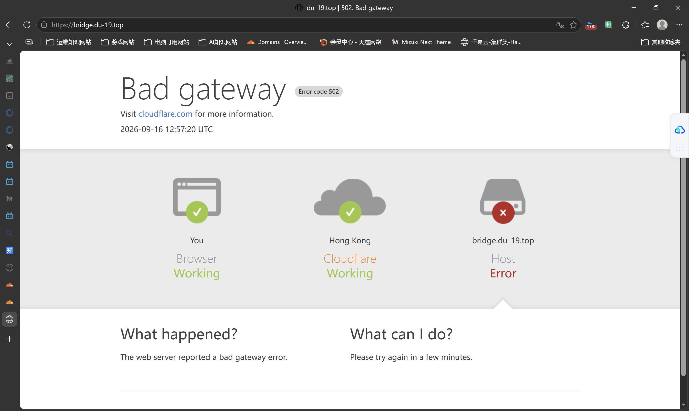

先别急着改配置。Cloudflare 这个错误页面上画着三个图标，那是最省时间的排障指南：

- **You（浏览器）正常**：你这边没问题
- **Cloudflare（边缘节点）正常**：域名解析、CDN、隧道入口都通
- **Host（源站）异常**：问题出在隧道出口之后，也就是我本机

请求已经穿过隧道到了我的电脑，但 cloudflared 去敲 `127.0.0.1:48271` 的门，屋里没人。

查端口：

```powershell
Get-NetTCPConnection -LocalPort 48271 -State Listen
# 查无此端口
```

原因很简单，也很蠢：**Bridge 应用本身没启动**。

隧道通的，DNS 对的，路由配的，断在最后一环。回 ShunCode 把 Bridge 起起来再查，48271 已经被 ShunCode 进程监听了。

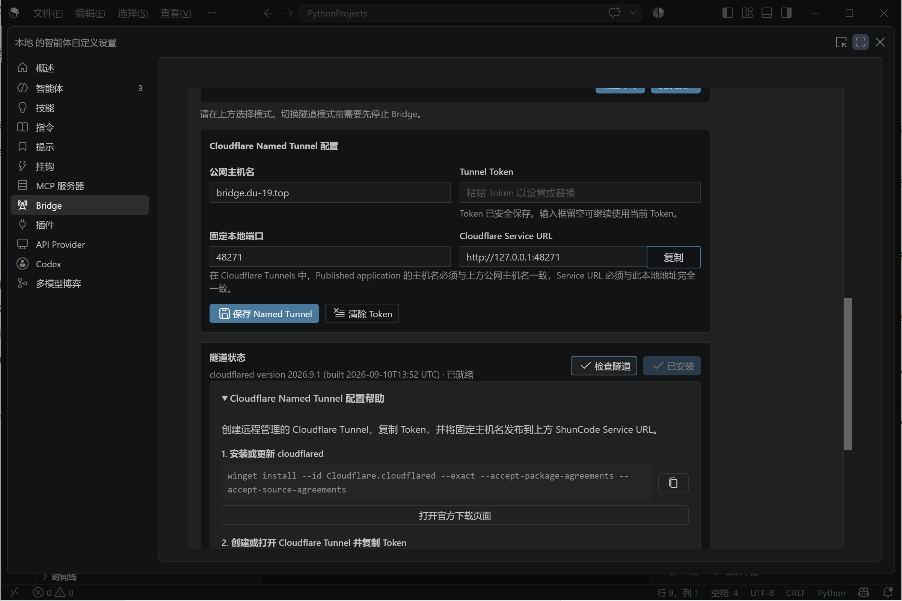

## 成功的样子是一行 JSON

再访问 `https://bridge.du-19.top`，浏览器显示：

```json
{"jsonrpc":"2.0","error":{"code":-32004,"message":"Not found"},"id":null}
```

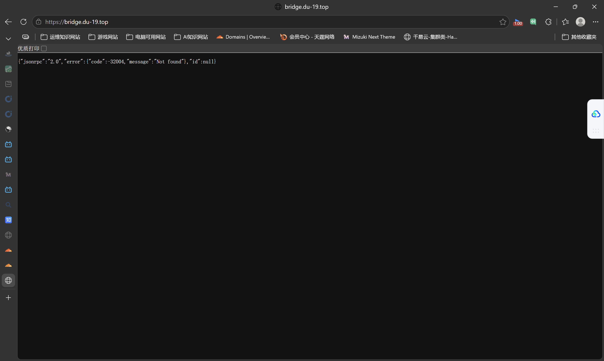

这不是错误页，是 Bridge 服务本尊在应答。

它是个 JSON-RPC 端点，根路径本来就没有网页，返回 Not found 是正常的。看到这段 JSON，说明请求走完了全程：浏览器、Cloudflare 边缘、加密隧道、本机 cloudflared、Bridge。

全链路通了。

## 终章：MCP 地址才是这套东西的价值

隧道通了，Bridge 面板会生成一个 `https://bridge.du-19.top/mcp/<访问令牌>` 形式的 MCP 地址。发给远程 AI 智能体（下图是 Arena 的 Agent 模式），对方立刻握手：

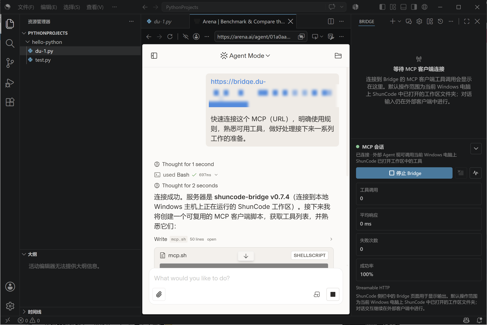

回来的消息是「连接成功。服务器是 shuncode-bridge v0.7.4（连接到本地 Windows 主机上正在运行的 ShunCode 工作区）」。

从此远程 AI 可以直接操作我笔记本上的工作区，读写文件、跑终端命令，流量全程走 Cloudflare 加密隧道。

> [!CAUTION]
> **MCP 地址等于你电脑工作区的钥匙**，谁拿到谁就能远程操作。所以三件事：
>
> 一、上面那张图的令牌我打了码，你也永远不要把完整 MCP 地址贴到任何公开场合。
> 二、Bridge 面板自己也警告「请勿公开 MCP 地址」，它知道这事有多严重。
> 三、想再加一道保险，可以在 Zero Trust 的 Access 里给 `bridge.du-19.top` 配一条邮箱验证策略，先过 Cloudflare 的登录墙才到得了服务。

## 复盘：五个坑，五种脸

| 环节 | 症状 | 根因 | 解法 |
| :--- | :--- | :--- | :--- |
| 软件安装 | 服务创建「没反应」 | 非管理员权限，静默失败 | UAC 提权后重装服务 |
| www 重定向 | 黄色警告 | www 无已代理的 DNS 记录 | 补 `A www → 192.0.2.1`（橙云） |
| 域名路由 | 流量去了 Pages 站 | 根域 CNAME 被博客占用 | Bridge 改用子域名 |
| 隧道路由 | 隧道里空空如也 | 从未发布过应用路由 | 添加 Published application |
| 本机服务 | 502 Bad Gateway | Bridge 应用没启动 | 启动 Bridge，端口开始监听 |

回头看，五个坑的故障形式全不一样：配置缺失表现为「警告」，路由冲突表现为「访问到了错误的站点」，服务没起表现为「502」。

所以遇到网关类错误，先看 Cloudflare 错误页那三个图标，哪个红了问题就在哪一段。这比在配置里瞎翻快一个数量级。

## 这套东西还能干什么

隧道常驻、域名在手之后，这台笔记本基本等于一台免费云服务器。往后的玩法都是同一套：起服务、加路由、验连通。

- **挂更多本机服务**：影音库、文件管理、本地大模型 API，加条路由就上线
- **接 Webhook**：AI 视频平台的任务回调、GitHub 事件，终于有了公网接收地址
- **私有 CIDR + WARP**：把笔记本变成 VPN 入口，在外面直接远程桌面回家
- **Access 策略**：给任何暴露的服务加登录墙

配完之后我最大的感受不是「学会了一个工具」，是「不用再求人了」。以前想在外面用家里的电脑，要么开远程软件，要么等人帮忙开机。现在它一直在那儿，域名记在脑子里。

> [!CAUTION]
> 本站分享的内容均为个人实战经验记录。文中涉及的域名、隧道 token、MCP 令牌等敏感信息均已脱敏，请勿在公开渠道泄露你自己的同类凭据。
