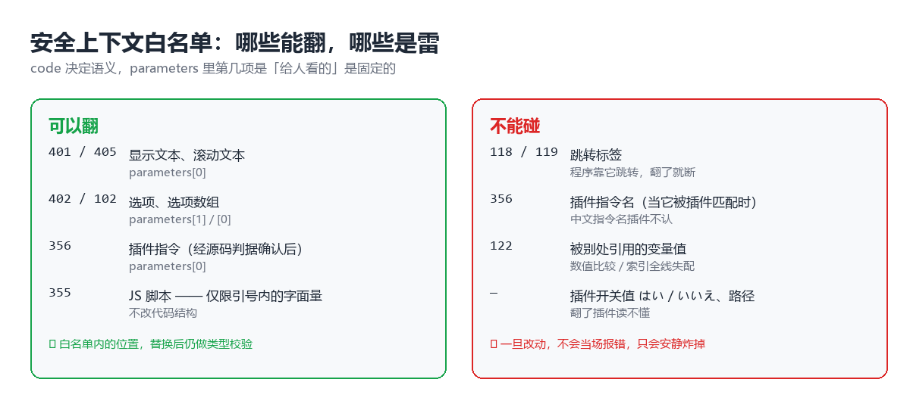
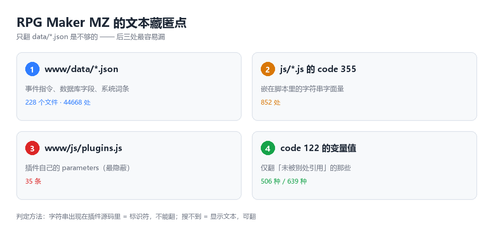

翻译词库是现成的，三万五千三百二十八条。

我以为这事一个下午就能结束。

> [!NOTE]
> 本文只谈工程。作品名称、资源地址、以及任何与作品内容相关的信息都不出现在文中——
> 这不是回避，而是因为这套方法对**任何一款 RPG Maker MZ / MV 游戏**都成立，
> 指名道姓反而会把读者的注意力从方法本身引开。

---

## 一、一个看起来毫无难度的任务

游戏的目录结构很标准：

```
www/
├── data/          228 个 .json   ← 地图、事件、道具、技能、系统词条
├── js/
│   ├── rmmz_*.js  引擎本体
│   └── plugins.js 插件清单 + 每个插件的参数
├── fonts/
└── img/
```

而手里的词库是 35328 条「日文 → 中文」的对照，覆盖了这款游戏绝大部分文本。

所以第一版的思路朴素得不能再朴素：

> 遍历 `data/` 下每一个 JSON 的每一个节点，只要是字符串、且在词库里能查到，就替换成中文。

九秒钟跑完，输出一行：

```
替换 44668 处（exact=43852, fuzzy=594, ctrl=218, norm=4）
```

四万五千多处。我当时觉得这活儿已经结束了。

---

## 二、第一次启动：白屏

双击 `Game.exe`，黑屏，然后什么都没有。

打开控制台，一行红字：

```
TypeError: $dataSystem.encryptionKey.split is not a function
```

`encryptionKey` 是系统的解密密钥，引擎启动时会拿它去 `.split()` 拆字节。
它变成了一个不是字符串的东西——因为我那个 `translate_text()` 函数返回的是
`(译文, 状态)` 这样一个**元组**，而我在某个分支里忘了拆包，直接把整个元组塞回了节点。

这是个低级 bug，改一行就好。

但真正的问题不是它。

> [!CAUTION]
> **这个报错只是冰山露出水面的那一角。**
> 它之所以能被看见，纯粹是因为 `encryptionKey` 位于启动路径上、且立刻被当成字符串使用。
> 而同一批替换里，还有 **5689 个节点**被以各种方式改坏——它们中绝大多数不会在启动时报错，
> 只会在玩家走到某一张地图、触发某一个事件、打开某一个菜单的时候，安静地炸掉。

我当时的选择是：从备份恢复，重跑。

但这个决定救得了一次，救不了一世——因为**根本的设计缺陷还在**：
脚本不知道自己在改什么。

---

## 三、三类运行时 bug，三种不同的「安静爆炸」

重跑之后进了游戏，玩了十分钟，出现三个互不相干的问题。

| 症状 | 位置 | 根因 |
|---|---|---|
| 插件功能失效、技能不生效 | `code 356`（插件指令） | 指令**名**被翻译了。插件按字符串匹配指令名，中文指令名它不认 |
| 界面上出现「错误 177-3」 | `code 122`（变量操作） | 变量的**值**被翻译了。后面拿这个值做数值比较 / 索引时全线失配 |
| 某张地图一进去就报脚本错误 | `code 355`（执行 JS 脚本） | 脚本里的**字符串字面量**被翻译了，译文里带的单引号把 JS 语法破坏了 |

这三类的共同点是：**它们长得都像「文本」，但语义上是代码。**

一个成熟的本地化方案，必须能区分这两者。而区分它们的依据，不能靠猜。

---

## 四、转折点：判定「该不该翻」，有一条可靠的判据

最初的判断方式是看这个字符串「像不像日文」。这显然不可靠——
「はい」（是）既是菜单选项也是开关值，「ロード」（读取）既是菜单也是插件参数。

真正可靠的判据是这一个：

> **去插件的 JS 源码里搜这个字符串。**
> - 搜得到 → 它是程序用来做匹配/分支的**标识符**，不能翻。
> - 搜不到 → 它只是被显示出来的**参数/文本**，可以翻。

这条判据立刻推翻了我先前的一个结论。

我原本把 `code 356` 整个判为「不可翻」并做了还原，因为它的第一个参数看着就像指令名。
但按上面的判据去查：356 在这款游戏里出现了 **1145 条，全部是单字符串**——
也就是说它并不是「指令名 + 参数」的结构，而就是一句要显示出来的话。

于是在收尾阶段把它整个翻了回去，**一次多出 849 处译文**。

> [!TIP]
> 判据要反过来用两次。
> 白名单能保证「翻的都安全」，但保证不了「该翻的都翻了」。
> 每一轮都要反向检查一次：**有没有显示文本落在白名单外面？**

---

## 五、事件指令 code 语义表

RPG Maker 把游戏逻辑存成一棵指令树，每条指令是一个数组：

```json
{ "code": 401, "indent": 0, "parameters": ["こんにちは"] }
```

`code` 决定这条指令干什么，`parameters` 里第几项是「可以给人看的文本」是**固定的**。
这就是所谓的安全上下文。

| code | 含义 | 可翻的参数下标 | 备注 |
|---|---|---|---|
| 401 | 显示文本（一行） | `[0]` | 最主要的文本来源 |
| 405 | 滚动文本 | `[0]` | 同上 |
| 402 | 选项 | `[1]` | `[0]` 是选项背景等 |
| 102 | 选项数组 | `[0]`（数组内每项） | |
| 118 / 119 | 跳转标签 | — | **不能翻**，程序靠它跳转 |
| 122 | 变量操作 | `parameters[4]`（有条件） | 见下文 |
| 355 | 执行 JS 脚本 | 引号内的字面量 | 只能改引号内，不能碰代码结构 |
| 356 | 插件指令 | `[0]` | 需先用第四节的判据确认 |

`122` 是最麻烦的一个。它的 `parameters[4]` 有时候是显示用的文本，
有时候是给脚本用的变量名——比如 `"触手"`、`$gameActors.actor(1).ep`、`"Heroine Pinch"`。

处理方式：**先全量统计「这个变量值有没有在别处被引用过」，只翻引用数为 0 的那些。**
639 种值里，506 种可以安全翻，133 种跳过。

于是 v2 的核心就是一张表：

```python
SAFE_CODE_PARAM = {
    401: {0},      # 显示文本
    405: {0},      # 滚动文本
    402: {1},      # 选项
    102: {0},      # 选项数组
}
```

外加数据库字段白名单（`DB_FIELDS`）和系统词条白名单（`SYSTEM_ARRAYS`），
以及一道 **616 万节点的类型校验**：凡是替换完不再是字符串、或者类型发生了变化的，直接拒绝写入。



---

## 六、翻译记忆四级查表：1670 条缺口是怎么压到 958 条的

词库有 35328 条，但仍有 1670 条文本查不到——主要是拟声词、语气词、带标点的变体。

直接上机器翻译当然可以，但这批文本大多是「っ!?」「えっ!?」「――ッ！？」这种
**短到没有任何上下文、且一译多日文极多**的东西，机翻质量很差，而且 7.4 万字是有成本的。

所以先做归一化，用四级查表：

```
第 1 级  精确匹配        「っ!?」
第 2 级  去控制符后匹配   剥掉 \c[n] \v[n] \n[n] 等控制符
第 3 级  归一化后匹配     再去首尾标点、去空白、全角半角统一
第 4 级  模糊匹配        difflib.SequenceMatcher，阈值 0.72
```

**1670 条 → 958 条，字数从 7.4 万降到 2.8 万。**
也就是说，三分之二的缺口根本不用翻译，它们只是「同一句话的不同写法」。

模糊匹配在 958 条规模上如果直接两两比对会很慢，所以加了一道**字符集合预筛**：
两个字符串如果连「用到的字符种类」都不重叠，就不必算相似度。提速约 30 倍。

> [!WARNING]
> 阈值 0.72 是试出来的，不是算出来的。
> 调到 0.65 开始出现「把不同台词压成同一句译文」的误匹配；
> 调到 0.80 命中率掉一半。**这种参数一定要在真实数据上看抽样结果再定。**

---

## 七、控制符：一个让译文悄悄丢掉颜色的坑

RPG Maker 的文本里嵌着大量控制符：

```
\c[27]♡絶頂        ← \c[27] 表示「从第 27 号配色取色」
\v[12] という名前    ← \v[12] 表示「插入 12 号变量的值」
\{ \} \$ \. \^       ← 放大、缩小、加粗等
```

第一版处理时，我拿「去掉控制符的纯文本」去查词库，查到之后**把译文直接写回**——
控制符就这么没了。

结果是插件参数里 `\c[27]♡絶頂` 变成了光秃秃的「高潮」，颜色丢失：

```
翻之前： \c[27]♡絶頂
翻之后： 高潮          ← \c[27] 丢了
```

正确做法是两步：

1. **先把前导的控制符块拆出来**（`\c[27]` 这种一定在开头）
2. **翻译时把控制符替换成 Unicode 私用区占位符**（`N`），翻完再换回去

私用区（U+E000–U+F8FF）是 Unicode 专门留给应用自定义的区段，
正常文本绝不会用到，所以是天然的「安全占位符」。

修完之后：

```
\c[27]♡高潮     ← 颜色保住了
```

---

## 八、四处藏匿点：文本不止活在 data/ 里

我以为翻完 228 个 JSON 就结束了。结果打开游戏，状态面板上还是一片日文。

日文文本在这个引擎里有**四个藏匿点**，只翻第一个是不够的：



| # | 位置 | 形态 | 本次规模 |
|---|---|---|---|
| 1 | `www/data/*.json` | 事件指令、数据库字段、系统词条 | 228 个文件，44668 处 |
| 2 | `www/js/*.js` 的 `code 355` | 嵌在脚本里的字符串字面量 | 852 处 |
| 3 | `www/js/plugins.js` | 插件自己的 parameters | 35 条 |
| 4 | `code 122` 的变量值 | 显示用的变量内容 | 506 种 |

**第 3 个最隐蔽**，也最容易漏——因为插件面板上的文字（状态面板的「開発度」「不覚」「調教」「絶頂」、
菜单的「ロード」）根本不在 data 里，它们是插件的作者写在插件参数里的。
你在 data 里搜破天也搜不到。

而且 `plugins.js` **不是合法 JSON**，它长这样：

```js
// Generated by RPG Maker. Do not edit this file directly.
var $plugins = [ ... ];
```

要解析得手动切：

```python
raw = open("plugins.js", encoding="utf-8").read()
data = json.loads(raw[raw.find("["): raw.rfind("]") + 1])
```

翻插件参数还要额外小心三类东西：

- `はい` / `いいえ` —— 这是开关**值**，翻了插件就读不懂
- `[...]` / `{...}` —— 里面是插件指令名，不是给人看的
- 含 `/` 或 `.png` 的 —— 是路径

---

## 九、繁体字：zhconv 不认识日式新字体

词库是繁体的，需要转简体。用 `zhconv` 转完之后，界面上还有一批字没变：

```
撃  気  価  覚  剣  氷  薬  営  囲  徳
```

原因很有意思：**这些不是繁体字，是日本简化后的「新字体」。**

汉字简化是各搞各的——中国大陆推简体，日本推新字体，两边对同一个字选了不同的简化路径。
所以「撃」在中文里对应的是「击」，而 `zhconv` 的繁简表里根本没有它，因为**它不是繁体**。

解决办法是自己补一张映射表：

```python
JP_VARIANT = {
    "撃": "击", "気": "气", "価": "价", "覚": "觉",
    "剣": "剑", "氷": "冰", "薬": "药", "営": "营",
    "囲": "围", "徳": "德", "転": "转", "観": "观",
    # ... 约 90 条
}
```

还踩到一个小坑：`ＨＰ`（全角）死活不转。原因是判断「是否含中日文字」的正则只写了
`[\u4e00-\u9fff]`，**漏了全角区 `[\uff01-\uff5e]`**，而 `ＨＰ` 的 `Ｈ` 就在全角区。

---

## 十、豆腐块：字体比翻译更难收尾

翻完之后进游戏，满屏「豆腐块」（□）——因为默认字体不含中文。

换成等线（`Deng.ttf`）之后，简体汉字覆盖率到了 100%，但游戏里还有一批符号等线没有：

```
♡  ♥  ♪  ❤  ⇑  ◯  ・  …
```

这些符号在日文字体 `mplus-1m-regular.ttf` 里有。于是用**双 `@font-face` + `unicode-range`**：
等线打底，mplus 只兜底那几个符号。

```css
@font-face {
  font-family: "GameFont";
  src: url("Deng.ttf") format("truetype");
}
@font-face {
  font-family: "GameFont";
  src: url("mplus-1m-regular.ttf") format("truetype");
  unicode-range: U+2661, U+2665, U+266A, U+2764, U+21D1, U+25EF, U+30FB;
}
```

这样浏览器/引擎会先用等线渲染汉字，遇到那 7 个码位自动回退到 mplus。

---

## 十一、免费的代价：885 条请求，零条成功

剩下的短促拟声词需要机翻。试了一圈免费接口：

| 接口 | 结果 |
|---|---|
| Google / Bing / Yandex / DeepL | 不通 |
| LibreTranslate / lingva | 不通 |
| **MyMemory** | **可用** |

MyMemory 是唯一能用的。它有匿名额度，我按 50 条一批落盘，跑了 23 分钟。

结果是：

```
...800/885 成功 0 失败 800
完成: 成功 0, 失败/跳过 885
```

**885 条，全部失败。** 匿名额度被限流掐死了，而且它返回的是 HTTP 200 带错误体——
不解析响应内容的话，看上去还以为成功了。

最后靠一张 **260 条的人工对照表**收尾（「っ!?」→「唔!?」、「えっ!?」→「诶!?」、
「レッツゴー♪」→「出发吧♪」），剩下的 887 条就这么挂了几天。

后面几节是几天后回来补完的——**那 887 条最后一条不剩地翻完了，
但过程比我预想的曲折得多。**

> [!TIP]
> 这类批处理脚本一定要**每 N 条落盘一次**，且**合并已有结果而不是覆盖**。
> 这次跑了 23 分钟全废，但因为中途有落盘、且二次运行时会读回已有词库，
> 前面几轮攒下的 258 条一条都没丢。

---

## 十二、一个意外的发现

用户后来下载了一个「新版本」，说旧版 bug 多。

我对两个版本的 228 个 data 文件做了哈希比对：

```
228 / 228 个文件，哈希 100% 相同
```

所谓「新版本修了 bug」这件事，在 data 层面**根本没有发生**。
差异只在两处：新目录是干净的（没有被我改坏的文件），以及自带的词库更全（35692 条 vs 35328 条）。

这个发现值 20 分钟的下载时间。

> [!NOTE]
> 遇到「换个版本试试」的冲动，先花 30 秒做哈希比对。
> 二进制一致就意味着差异不在你认为的地方。

---

## 十三、换源：代理后面还有一个 Google

卡了几天之后回来看，MyMemory 倒是恢复响应了——但质量崩了：

```
こんにちは  ->  penian ferein OU潘托斯所有安卓sofou
```

它的翻译记忆被污染了。`quotaFinished` 是 `false`，HTTP 状态是 200，
**返回的东西却完全是垃圾**。

> [!WARNING]
> 「接口返回 200」和「接口能用」是两件事。
> 判断一个翻译源是否可用，要用**你自己语料里的句子**去试，而不是看状态码。

转机在这台机器上：它跑着一个本地代理（`127.0.0.1:7897`）。
既然代理能出去，那就没必要吊死在被污染的免费源上：

```python
url = ('https://translate.googleapis.com/translate_a/single'
       '?client=gtx&sl=ja&tl=zh-CN&dt=t&q=' + quote(text))
subprocess.run(['curl', '-sS', '-x', 'http://127.0.0.1:7897', url])
```

同一句话，两个源的结果：

```
MyMemory : 精力充沛的护符。每回合装备的 TP 越多。
Google   : 一个能让你振作起来的护身符。每回合 TP 随着装备数量的增加而增加。
```

后面所有补翻都走这条路，**123 条零失败**。

---

## 十四、本地消化才是大头

换好源之后我做了一件之前偷懒没做的事：**先把这 891 条拿去跟主词库（39346 条）硬碰一遍**，

```
第 1 级  精确匹配
第 2 级  去控制符后匹配
第 3 级  归一化后匹配
第 4 级  模糊匹配（difflib，阈值 0.72）
第 5 级  按换行切段，逐段查表再拼回去
```

结果是：

```
待处理 891 条
本地消化 625 条   ← 根本不用调 API
需走 API 258 条
```

**891 条里，三分之二压根不需要翻译。**

第 5 级（分段拼装）是这次新加的，专治「同一句式 + 少量差异」。
这批文本里光是护符类道具就有这么一族：

```
元気が出るお守り。毎ターン装備している数だけTPがちょっとだけ増える。
元気が出るお守り。毎ターン装備している数だけTPが増える。
元気が出るお守り。毎ターン装備している数だけTPが多めに増える。
```

整句查表查不到，但按 `\n` 切开之后，「元気が出るお守り。」和「毎ターン装備している数だけ」
各自都能命中，拼起来就是完整译文。

> [!TIP]
> **任何批量翻译，先做本地消化再调 API。**
> 我第一版直接把 891 条全扔给 API，既慢又贵，还引入了后面那场事故。

---

## 十五、一次 751 条的事故：占位符被翻译引擎吃掉了

翻完第一轮，界面上开始出现这种东西：

```
原文: \c[10]クリティカル率の低下\c[0]、\c[11]回避率の低下\c[0]…
译文: 0暴击率减免1、2闪避率减免3、4魔法攻击减免5以上
```

控制符全没了，只剩下占位符里的**数字**。

原因是我用 Unicode 私用区（U+E000 起）做占位符保护控制符：
`\c[10]` → `0`。而 Google 会**把 PUA 字符吃掉**，只留下中间那个 `0`。
unmask 时模式匹配不上，控制符就永远丢了。

改成 ASCII token（`XQ0QX`）之后，Google 原样保留，控制符保住了：

```
这里我们将减少\c[3]色情激光器\c[0]放置的数量     ← 正确
```

### 但真正让事故变大的是另一件事

我其实写了「控制符数量必须守恒」的体检函数。它应该能拦住这批坏译文。

它一条都没拦住——因为**正则本身是坏的**。

排查时我在命令行里这么写的：

```bash
python -c "... re.compile(r'\\+(?:C|V|N|...)\s*\[[^\[\]]*\]') ..."
```

bash 的双引号会吃掉一层反斜杠，`\\+` 传到 Python 里变成了 `\+`。
正则于是从「匹配一个或多个反斜杠」变成了「匹配一个或多个加号」——
**它永远匹配不到 `\c[10]`，`findall` 恒返回空列表，两边都是 0，守恒检查永远通过。**

> [!CAUTION]
> **别在 shell 的双引号里内联带反斜杠的正则。**
> 写到 `.py` 文件里再跑。
> 这个错误最阴险的地方是：它不会报错，只会让校验**静默失效**——
> 一个永远返回「通过」的检查，比没有检查更危险。

修正后重新体检，结果触目惊心：

```
词库 1148 条 | 受损 751 条
   控制符 1->0: 359
   控制符 2->0: 292
   ...
```

**65% 的译文是坏的。** 全部清除，重翻。

### 兜底方案：分段翻译

重翻时我加了一道回退。如果整体翻译（占位符方案）体检不过，就退到**分段翻译**：

```python
def translate_segmented(s):
    out = []
    for p in SPLIT.split(s):        # 按控制符切开
        if CTRL.fullmatch(p) or not p.strip():
            out.append(p)           # 控制符原样保留
        else:
            out.append(translate_piece(p) or p)
    return ''.join(out)
```

牺牲一点上下文连贯性，但**控制符 100% 守恒**——因为它根本不经过翻译引擎。

最终：本地消化 478 条 + API 34 条，全部通过体检。

---

## 十六、一个认知修正：`note` 字段不该翻

补翻收尾时，我统计「还剩多少日文」，得到 30 条。仔细一看，大半是这样的：

```
<AOP ep Level 1 Value: 260>
<IgnoreRecoverDie>
ステート媚薬
```

这些全在 **`note` 字段**里。而 `note` 是**给插件读的备注**，不是给玩家看的文本——
里面那些 `<AOP Param 0 Plus: 150>` 是插件的解析指令，翻了反而可能把它搞坏。

玩家真正看得见的字段只有这几个：

```python
VISIBLE = {'name', 'description', 'message1..4', 'profile', 'nickname'}
```

外加 `code` 401 / 405 / 402 / 102 这几个位置。

**把 `note` 排除之后：30 条 → 9 条，再去掉调试标记和代码片段，真正待翻 0 条。**

> [!NOTE]
> 统计覆盖率时，**先确认你统计的东西是不是用户真能看见的**。
> 我一度以为还差 887 条，实际上其中大部分根本不需要翻——
> 这个误判让我在错误方向上多花了好几天。

---

## 十七、最终数字

| 项目 | 数量 |
|---|---|
| 处理的 JSON 文件 | 228 |
| 数据内替换 | 44668 处 |
| 脚本字面量（`code 355`） | 852 处 |
| 插件参数（`plugins.js`） | 35 条 |
| 变量值（`code 122`） | 506 种 |
| 繁转简 + 日式新字体 | 194 处 |
| **补译词库** | **907 条** |
| 其中来自主词库（本地消化） | 602 条 |
| 其中本次 API 翻译 | 307 条，**控制符体检 0 受损** |
| 人工重译 / 回滚 | 2 条 / 5 条 |
| **玩家可见文本待翻** | **0 条** |

校验结果：**228 个 JSON 全部合法，控制符残骸 0，游戏正常启动**。

剩下那几条「含日文」的其实是误判——它们只含一个日文长音符号「ー」，
比如「忍符・发情」「电脑数量　　ー」，主体早就已经是中文了。

---

## 十八、这套方法能复用在哪

回头看，这篇里真正值钱的不是那些数字，是四个可以迁移的思路：

**1. 安全上下文优于字符串匹配。**
批量改写结构化数据时，先花时间把「哪些位置可以改」列成一张表，再动手。
多花的两小时，换来的是不用在游戏里盲测三小时。

**2. 判定依据要可验证，不要凭直觉。**
「这个字符串像不像文本」是直觉；「它有没有出现在插件源码里」是可验证的事实。
凡是能改成后者的判断，都要改。

**3. 归一化优先于翻译。**
891 条缺口里，有三分之二其实是同一句话的不同写法。
先归一化、再去调 API，成本直接砍到三分之一。

**4. 校验本身也要被校验。**
这次最大的坑不是「没写体检」，而是「写了体检但它一直是失效的」——
一个永远返回通过的检查，比没有检查更危险，因为它给你虚假的安全感。
**任何校验逻辑，都要拿一组已知会失败的样本去验证它真的会失败。**

这套流程对 RPG Maker MZ / MV 的任何一款游戏都成立，
对「结构化数据的大批量定向改写」这类问题也成立（配置迁移、字段重命名、国际化）。

---

## 十九、收尾

工程做完之后回头看，最花时间的三件事分别是：

1. 搞明白「哪些位置能改」（安全上下文表）
2. 发现「不用翻的比要翻的多」（归一化 + 本地消化 + 排除 `note`）
3. 修那个静默失效的正则（751 条事故）

反倒是"翻译"本身——那个我以为会是主角的环节——只占了很小的比重。

**这大概是这类工程普遍的真相：难点从来不在翻译，在于判断什么该翻、什么不该翻，
以及怎么验证你翻对了。**
